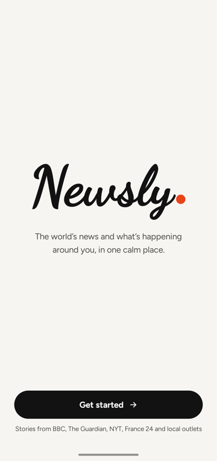
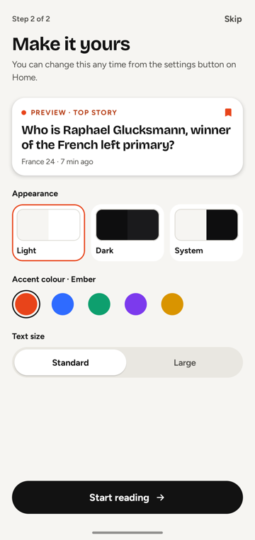
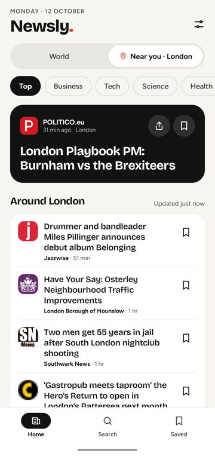
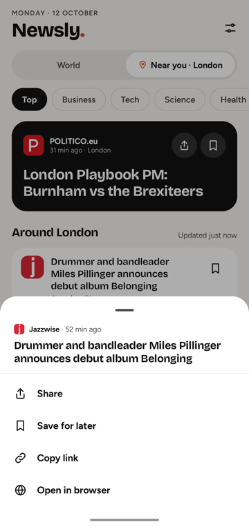
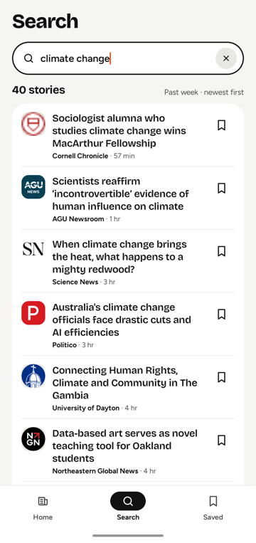
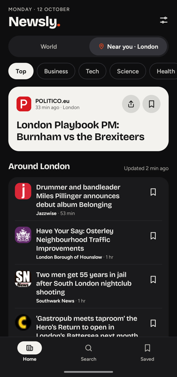

<p align="center"></p>

# Newsly

A clean, modern news reader for Android. Newsly puts **world headlines** and **news from where you are** side by side, with categories, search, bookmarks and offline reading, all in a calm editorial design.

Built with Kotlin and Jetpack Compose. No API key or account needed.

## Screenshots

| Welcome | Make it yours | Near you |
|:---:|:---:|:---:|
|  |  |  |

| Story options | Search | Dark mode |
|:---:|:---:|:---:|
|  |  |  |

<sub>Screenshots show headlines and publisher logos from live feeds; the World feed's story photos belong to their publishers and aren't reproduced here.</sub>

## Features

- **World and Near you.** Top stories from about twenty outlets across every region, including BBC News, The Guardian, The New York Times, Al Jazeera, South China Morning Post, The Japan Times, CNA, The Hindu, Arab News, Africanews, Nation (Kenya), Buenos Aires Times and Euronews. Next to them is local news for your city, topped up with stories from across your country, detected from your approximate location.
- **Any country.** Filter World to a single country, from a searchable list of every country, to see news from and about it.
- **Sort.** Order stories by *Latest*, *Top picks* (each outlet's leading stories first, taking turns) or *By outlet*.
- **Categories.** Top, Business, Tech, Science, Health, Sports and Entertainment, for both world and local news.
- **Search.** Results appear as you type, covering the past week across thousands of outlets, with recent searches kept for quick reuse.
- **In-app reading.** Tap a story for a preview with its photo and summary, then read the full article on the publisher's page without leaving the app.
- **Share anything.** A share button on top stories, and a long-press menu on every story to share, save, copy the link or open it in the browser.
- **Bookmarks.** Save stories to a Saved grid that stays readable offline, with undo on removal.
- **Always fresh, offline first.** Every feed is saved on the device, so the app opens instantly. Coming back after a while refreshes anything older than 10 minutes in the background: if you're at the top the new stories just appear, and if you're mid-read a "new stories" pill lets you jump up when you're ready. Offline, a clear banner says how old the stories are.
- **Follows you.** Travel to another city and Near you switches to it the next time you open the app.
- **Make it yours.** Light, dark or system theme, five accent colours and a larger text option, chosen on first launch and changeable any time.
- **First-launch welcome.** The Newsly wordmark writes itself out like pen on paper. It respects the system's reduced-motion setting.

## Tech stack

| Area | Library |
|---|---|
| UI | Jetpack Compose, Material 3 |
| Architecture | ViewModel + StateFlow, repository pattern, manual dependency container |
| Networking | OkHttp, Android's XmlPullParser for RSS / Media RSS |
| Images | Coil, with a 150 MB disk cache for offline photos |
| Storage | Room (bookmarks, feed cache), SharedPreferences (settings, recent searches) |
| Location | Fused Location Provider (coarse only) + Geocoder |
| Reading | WebView reader, Chrome Custom Tabs for "Open in browser" |

Min SDK 26 (Android 8.0), target SDK 35.

## Getting started

Requirements: Android Studio (Ladybug or newer) with JDK 17+, and the Android 15 (API 35) SDK.

1. Clone the repository:
   ```bash
   git clone https://github.com/ashifReza/newsly.git
   ```
2. Open the project in Android Studio and let Gradle sync.
3. Run the `app` configuration on a device or emulator.

Or from the command line:

```bash
./gradlew installDebug
```

### Testing Near you in other places

Debug builds can pretend to be somewhere else, so you can check local news without travelling. Leave the app and come back after each command; it picks up the new place on return.

```bash
adb shell "am broadcast -a com.example.newsly.DEBUG_SET_LOCATION --es city Paris --es country_code FR --es country France"
adb shell am broadcast -a com.example.newsly.DEBUG_SET_LOCATION --ez clear true
```

Release builds don't include this.

## Project structure

```
app/src/main/java/com/example/newsly/
├── data/
│   ├── remote/       RSS client, publisher feeds, Google News feeds
│   ├── cache/        Room database holding the last copy of every feed
│   ├── bookmarks/    Room database for saved stories
│   ├── NewsRepository.kt   Show-saved-then-refresh logic, search cache
│   ├── AppSettings.kt      Theme, accent, text size, onboarding state
│   └── Category.kt, RecentSearches.kt, Article.kt
├── location/         Approximate location → city and country, with fallbacks
├── ui/
│   ├── theme/        Colours, typography, text scaling
│   ├── components/   Cards, chips, toggles, banners, line icons
│   ├── onboarding/   Pen-written wordmark, theme picker
│   ├── HomeScreen.kt, SearchScreen.kt, SavedScreen.kt
│   ├── ArticleDetailScreen.kt, ArticleWebScreen.kt
│   ├── NewsApp.kt          Bottom navigation and screen stack
│   └── NewsViewModel.kt
└── util/             Sharing, Custom Tabs
```

## How the news is sourced

- **World** comes straight from publishers' own RSS feeds, which include photos and summaries. Each outlet contributes at most 5 stories to Top (10 to other categories) so no single source dominates. Filtering to a country uses Google News coverage of it, plus that country's own outlets where listed.
- **Near you** combines Google News RSS (the city's feed, a city search and a country-wide search) with the country's own outlets' feeds, which carry photos. Outlets are listed for Bangladesh, the UK, the US, India, Pakistan, Australia, Ireland and Nigeria in `PublisherFeeds.kt`; other countries show Google News stories only. When a story arrives from both, the outlet's copy (with its photo) is kept, and no outlet gets more than 8 stories.
- **Search** uses Google News RSS. Google News doesn't carry photos, so those cards show the publisher's logo instead.
- Stories from feeds without photos (Al Jazeera) get the article page's preview image (`og:image`), looked up once per story and saved.
- Stories open on the publisher's own page, as the publisher serves it, including their ads and paywalls. Newsly doesn't scrape or republish article text.
- Only coarse location is requested, and only the resulting city and country name is used. Coordinates never leave the device.

### Before publishing to a store

Google News RSS is unofficial: its format can change without notice, and its terms for use in published apps are unclear. Publisher feeds have their own terms too, and some allow personal use only. Before a public release, move to a licensed news API (for example NewsData.io) behind your own backend, which also lets you cache responses for all users and keep any API keys off the device.

## Design

- **Type:** Bricolage Grotesque for headlines, Figtree for body text, and Dancing Script for the welcome wordmark.
- **Colour:** an off-white / near-black base with one accent colour (Ember by default).
- **Shape:** large rounded cards, pill controls, and a Home / Search / Saved bottom bar.

## Logo

The Newsly mark is an original design: a single pen-stroke "N" followed by the accent dot from the "Newsly." wordmark. The source is [`docs/logo.svg`](docs/logo.svg); the Android adaptive icon (with a themed-icon layer) is in `app/src/main/res/drawable/ic_launcher_*.xml`.

## Third-party licences

The fonts are bundled from [Google Fonts](https://fonts.google.com) under the SIL Open Font License 1.1. The licence texts are in [`third_party_licenses/fonts/`](third_party_licenses/fonts/).

News content, logos and photos belong to their respective publishers.
