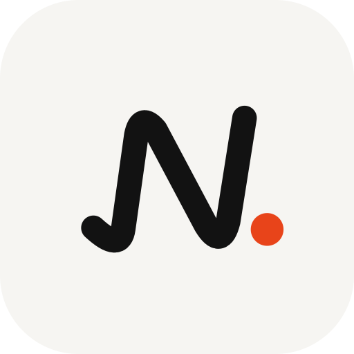

<p align="center"></p>

# Newsly

A clean, modern news reader for Android. Newsly puts **world headlines** and **news from where you are** side by side, with categories, search, bookmarks and offline reading, all in a calm editorial design.

Built with Kotlin and Jetpack Compose. No API key or account needed.

## Features

- **World and Near you.** Top stories from BBC News, The Guardian, The New York Times and France 24, plus local news for your city (falling back to your country), detected from your approximate location.
- **Categories.** Top, Business, Tech, Science, Health, Sports and Entertainment, for both world and local news.
- **Search.** Results appear as you type, covering the past week across thousands of outlets, with recent searches kept for quick reuse.
- **In-app reading.** Tap a story for a preview with its photo and summary, then read the full article on the publisher's page without leaving the app.
- **Bookmarks.** Save stories to a Saved grid that stays readable offline, with undo on removal.
- **Offline first.** Every feed is saved on the device. The app opens instantly with the last stories, refreshes them in the background, and shows a clear banner when you're offline.
- **Make it yours.** Light, dark or system theme, five accent colours and a larger text option, chosen on first launch and changeable any time.
- **First-launch welcome.** The Newsly wordmark writes itself out like pen on paper. It respects the system's reduced-motion setting.

## Tech stack

| Area | Library |
|---|---|
| UI | Jetpack Compose, Material 3 |
| Architecture | ViewModel + StateFlow, repository pattern, manual dependency container |
| Networking | OkHttp, Android's XmlPullParser for RSS / Media RSS |
| Images | Coil, with a 150 MB disk cache for offline photos |
| Storage | Room (bookmarks, feed cache), SharedPreferences (settings, recent searches) |
| Location | Fused Location Provider (coarse only) + Geocoder |
| Reading | WebView reader, Chrome Custom Tabs for "Open in browser" |

Min SDK 26 (Android 8.0), target SDK 35.

## Getting started

Requirements: Android Studio (Ladybug or newer) with JDK 17+, and the Android 15 (API 35) SDK.

1. Clone the repository:
   ```bash
   git clone https://github.com/ashifReza/newsly.git
   ```
2. Open the project in Android Studio and let Gradle sync.
3. Run the `app` configuration on a device or emulator.

Or from the command line:

```bash
./gradlew installDebug
```

## Project structure

```
app/src/main/java/com/example/newsly/
├── data/
│   ├── remote/       RSS client, publisher feeds, Google News feeds
│   ├── cache/        Room database holding the last copy of every feed
│   ├── bookmarks/    Room database for saved stories
│   ├── NewsRepository.kt   Show-saved-then-refresh logic, search cache
│   ├── AppSettings.kt      Theme, accent, text size, onboarding state
│   └── Category.kt, RecentSearches.kt, Article.kt
├── location/         Approximate location → city and country, with fallbacks
├── ui/
│   ├── theme/        Colours, typography, text scaling
│   ├── components/   Cards, chips, toggles, banners, line icons
│   ├── onboarding/   Pen-written wordmark, theme picker
│   ├── HomeScreen.kt, SearchScreen.kt, SavedScreen.kt
│   ├── ArticleDetailScreen.kt, ArticleWebScreen.kt
│   ├── NewsApp.kt          Bottom navigation and screen stack
│   └── NewsViewModel.kt
└── util/             Sharing, Custom Tabs
```

## How the news is sourced

- **World** comes straight from publishers' own RSS feeds, which include photos and summaries. Each outlet contributes at most 12 stories per feed so no single source dominates.
- **Near you** and **Search** use Google News RSS (city, place and search feeds). These don't carry photos, so cards show the publisher's logo instead.
- Stories open on the publisher's own page, as the publisher serves it, including their ads and paywalls. Newsly doesn't scrape or republish article text.
- Only coarse location is requested, and only the resulting city and country name is used. Coordinates never leave the device.

### Before publishing to a store

Google News RSS is unofficial: its format can change without notice, and its terms for use in published apps are unclear. Publisher feeds have their own terms too, and some allow personal use only. Before a public release, move to a licensed news API (for example NewsData.io) behind your own backend, which also lets you cache responses for all users and keep any API keys off the device.

## Design

- **Type:** Bricolage Grotesque for headlines, Figtree for body text, and Dancing Script for the welcome wordmark.
- **Colour:** an off-white / near-black base with one accent colour (Ember by default).
- **Shape:** large rounded cards, pill controls, and a Home / Search / Saved bottom bar.

## Logo

The Newsly mark is an original design: a single pen-stroke "N" followed by the accent dot from the "Newsly." wordmark. The source is [`docs/logo.svg`](docs/logo.svg); the Android adaptive icon (with a themed-icon layer) is in `app/src/main/res/drawable/ic_launcher_*.xml`.

## Third-party licences

The fonts are bundled from [Google Fonts](https://fonts.google.com) under the SIL Open Font License 1.1. The licence texts are in [`third_party_licenses/fonts/`](third_party_licenses/fonts/).

News content, logos and photos belong to their respective publishers.
